# Doctor Tracker — secure admin portal

A full-stack clinic register: a Next.js 16 admin portal in front of a Node/Express 5 REST API on MongoDB Atlas. Doctors and their patients are CRUD-manageable, searchable, filterable, sortable and paginable, with an aggregated dashboard behind a JWT session.

---

## Description

Clinics run on spreadsheets. Doctor Tracker replaces the spreadsheet with a single admin portal where a practice keeps its register of doctors and, under each doctor, the patients they track — with the clinical detail that actually gets asked about: condition, severity, blood group, visit date. Everything a reviewer asks of a register is here: free-text search across name, email, BMDC number and phone; dropdown filters for specialization, hospital, district, condition, gender and severity; date-wise ranges; server-whitelisted sorting on eight columns of the register and seven of the patient list; and pagination that survives a reload or a shared link because the query lives in the URL. The dashboard answers the standing questions without a query — how many doctors, how many patients, how many visits this week and month, which departments are busy, which doctors carry the most patients, and what the case mix looks like. Access is a single admin role behind httpOnly cookie sessions: no token ever reaches JavaScript.

**Stack:** Next.js 16 (App Router, Turbopack, React 19) · TanStack Query 5 · Recharts 3 · Tailwind CSS 4 · zod 4 · Express 5 · Mongoose 9 · MongoDB Atlas · TypeScript throughout.

---

## Setup Guide

### 0 — Clone

The portal is two repositories, deployed and run side by side. Clone them as siblings — the paths below assume it:

```bash
git clone https://github.com/Mayamoho/doctor-tracker-web.git
git clone https://github.com/Mayamoho/doctor-tracker-api.git
```

| Repo | |
|---|---|
| [`Mayamoho/doctor-tracker-web`](https://github.com/Mayamoho/doctor-tracker-web) | This one — the Next.js portal. |
| [`Mayamoho/doctor-tracker-api`](https://github.com/Mayamoho/doctor-tracker-api) | The Express + MongoDB REST API it talks to. |

### Prerequisites

| | |
|---|---|
| Node.js | `>= 20.19` — declared in both repos' `engines` (Next 16 itself asks for `>=20.9`; this is what everything was verified on) |
| MongoDB | An Atlas cluster URI, or any reachable `mongodb://` deployment |
| Package manager | npm |

### 1 — API

```bash
cd doctor-tracker-api
cp .env.example .env        # then fill in MONGO_URI and the two JWT secrets
npm install
npm run seed                # creates the admin user + 45 doctors / 600 patients
npm run dev                 # http://127.0.0.1:5000/api/v1
```

Generate the two secrets with different values:

```bash
node -e "console.log(require('crypto').randomBytes(48).toString('hex'))"
```

`.env.example` documents every variable — server port, `MONGO_URI`, the access/refresh secret pair and their TTLs, `CLIENT_ORIGIN`/`COOKIE_SECURE` for the direct-origin case, and the seed knobs (`SEED_DOCTORS`, `SEED_PATIENTS`, `ADMIN_EMAIL`, `ADMIN_PASSWORD`).

### 2 — Web

```bash
cd ../doctor-tracker-web
cp .env.example .env.local  # API_INTERNAL_URL, defaults to http://127.0.0.1:5000
npm install
npm run dev                 # http://localhost:3000
```

### 3 — Sign in

```
http://localhost:3000/login
admin@doctortracker.dev / Admin@1234
```

Those are the seeded development credentials from `.env.example`, and they exist only in the demo database.

### Why `localhost` and not `127.0.0.1` in development

Next 16 blocks cross-origin dev resource requests, so opening the dev server on `127.0.0.1` serves HTML that never hydrates. `next.config.ts` carries `allowedDevOrigins: ["127.0.0.1"]` so the alternative host works too, but `localhost` is the primary.

### Production build

```bash
cd doctor-tracker-api && npm run build && npm start
cd doctor-tracker-web  && npm run build && npm start
```

Set `API_INTERNAL_URL` to the API's private origin. The browser never sees that host: every call goes to the web origin and is rewritten (see below), which is what keeps the cookies first-party.

To put the pair on the internet instead of `localhost` — Render for the API, Vercel for the portal, with the exact variables and the cookie consequence — see [Deployment](#deployment).

---

## System Architecture

```
 browser ── same origin, httpOnly cookies ──►  Next.js 16 (web)
   │                                              │
   │  /api/v1/*  ─── rewrite ─────────────────►  Express 5 (api)
   │                                              │
   │                                              ├─ helmet · CORS · rate limit
   │                                              ├─ cookie-parser
   │                                              ├─ validate(zod)      ← request contracts
   │                                              ├─ requireAuth + requireRole('admin')
   │                                              ├─ controller → service → Mongoose model
   │                                              │        │
   │                                              │        └── $facet aggregation → MongoDB Atlas
   └──────────────────────────────────────────────┘
                                     JSON envelope { success, data, meta? }
```

### The one seam that matters

`next.config.ts` rewrites `/api/v1/:path*` to `API_INTERNAL_URL`. One origin for document, assets and data means the `dt_at` / `dt_rt` cookies are first-party host-only cookies — the only arrangement Safari's ITP does not clip — and it removes CORS from the picture entirely for the deployed app. `doctor-tracker-api/src/utils/cookies.ts` is written against exactly that assumption.

### Request lifecycle

1. **Route** (`src/routes/*.ts`) puts every resource behind `requireAuth` + `requireRole('admin')`; the only unauthenticated paths are `/auth/login`, `/auth/refresh` and `/auth/logout` — logout stays open on purpose, because revoking a session must work after its access token has already expired. `validate(schema)` runs on every body and route param.
2. **Validation** (`src/validation/*.schema.ts`) is zod, and it is the *only* place a request becomes trusted. Query strings are parsed by an explicit schema inside the service layer instead — `req.query` is a read-only getter in Express 5, so middleware cannot rewrite it. `utils/query.ts` clamps `limit` to 100, whitelists sort tokens and appends an `_id` tiebreaker so pages never repeat or drop a row.
3. **Controller** shapes the response; **service** owns the query. `doctorService` counts patients for a whole page in one `$group`, never one query per row.
4. **Errors** funnel into `middleware/errorHandler.ts`: zod issues become a 400 with a per-field `issues` array, duplicate keys become 409, everything else is logged and answered with a generic 500. The client renders `issues` straight onto the form fields.

### Endpoint surface

| Method | Path | Purpose |
|---|---|---|
| `POST` | `/api/v1/auth/login` · `/refresh` · `/logout` | cookie session |
| `GET` | `/api/v1/auth/me` | session probe |
| `GET` `POST` | `/api/v1/doctors` | search / filter / sort / paginate · create |
| `GET` `PATCH` `DELETE` | `/api/v1/doctors/:id` | read · update · delete (cascades patients) |
| `GET` `POST` | `/api/v1/doctors/:id/patients` | that doctor's patients · add one to them |
| `DELETE` | `/api/v1/doctors/:id/patients/:patientId` | unassign / remove |
| `GET` `POST` | `/api/v1/patients` | register-wide list (condition, gender, severity, visit-date range) · create |
| `GET` `PATCH` `DELETE` | `/api/v1/patients/:id` | read · update · delete |
| `GET` | `/api/v1/dashboard/stats` · `/filter-options` | `$facet` aggregates · dropdown vocabularies |

### Frontend layout

```
src/
  proxy.ts                     coarse auth gate (cookie presence → redirect)
  app/
    login/                     unauthenticated
    (portal)/                  dashboard · doctors · doctors/[id] · patients
  components/
    layout/ data/ ui/          shell, table+filter primitives, design-system atoms
    doctors/ patients/ dashboard/ charts/
  lib/
    api/                       fetch client, endpoints, query keys, types
    hooks/                     use-doctors / use-patients / use-dashboard / use-session
    list-state.ts              URL ⇄ query-parameter codec
```

`proxy.ts` is deliberately coarse: it checks that a session cookie *exists* so a signed-out visitor never sees a flashing empty dashboard. It does not verify tokens — verification belongs to the API, and duplicating JWT verification into the frontend would mean duplicating the secret into it. A tampered cookie passes the gate and is rejected by `requireAuth`.

### Where state lives

Server state is TanStack Query's cache, keyed in `lib/api/query-keys.ts`; a mutation invalidates the keys it dirties (`use-invalidate.ts`) and `keepPreviousData` keeps the table still while the next page loads. List state — page, sort, search, every filter, both dates — is encoded in the URL by `lib/list-state.ts` and decoded back into query parameters. Component state is reserved for what genuinely cannot be shared: the draft inside a form, which modal is open, the debounce timer.

---

## Technical Decisions

### 1 · Search over a normalized token array, not `$regex` over raw strings

The obvious implementation of a search box is `{ name: { $regex: term, $options: 'i' } }`. It is wrong twice over, and `npm run indexes` prints the planner's verdict for both failures against the seeded data:

```
IXSCAN     doctor search — anchored prefix on normalized tokens
             index: searchTerms_1        keys=3   docs=2   returned=2
IXSCAN*    doctor search — same term unanchored (the usual first attempt)
             index: searchTerms_1        keys=583 docs=45  returned=2
IXSCAN*    doctor search — anchored with the i flag on `name`
             index: name_1               keys=45  docs=0   returned=0
```

- **Unanchored reads the whole index.** `kamaruddin` anywhere in the string means no bounds, so the scan costs 583 index keys and 45 documents — the entire collection — to return two rows.
- **The `i` flag costs the same scan, and anchoring then returns nothing at all.** A case-insensitive pattern cannot use index bounds, so the third row reads every key in `name_1`; and because it is anchored, it still matches zero documents — `"Dr. Shamim Reza Kamaruddin"` does not *start* with `kamaruddin`. Both halves of the naive query are wrong, and the wrongness compounds: the expensive version is the one that finds nothing. This is the real reason for the token array: `Hossain` is a common surname in this data and is a prefix of *nothing* stored in `name`.

So each document carries `searchTerms`: lowercased alphanumeric tokens, produced by `utils/search.ts` and indexed once. Case-insensitivity comes from normalizing both sides instead of from a flag, and the collection deliberately carries **no ICU collation** — a collation of `strength: 2` turns every `$regex` into a collection scan, which is a worse trade than the one the flag was buying.

The query side reduces the box to a single term, and the two rules are both about what people actually type:

```ts
export function searchTerm(input: string): string | null {
  const trimmed = input.trim();
  if (/^[\d+()\s-]+$/.test(trimmed)) {
    return trimmed.replace(/\D/g, '') || null;      // "01712 345678" is one number
  }
  return tokenize(trimmed).at(-1) ?? null;          // "Abdul Karim" → karim
}
```

Digits are rejoined rather than split, because a phone typed with spaces or a `+` is one identifier — and `phoneVariants` indexes `+8801712345678`, `01712345678` and `1712345678` so all three spellings find the row. Everything else keeps its **last** token, which keeps the query to one bounded scan (`keys=3`) instead of an `$or` fan-out per word.

One consequence is documented rather than hidden: because only the last token is searched, pasting a complete email address searches `com` and returns the register. Searching the local part — `parvinanam60` — returns exactly the one doctor. Specialization and hospital are also deliberately *not* in the free-text index; they have dropdowns, and folding them in would make a search for `Dr` return everything.

Filter and sort get the same treatment as search: every path the UI can take has a compound index whose field order matches the query, so the sort is free rather than an in-memory pass —

```
IXSCAN  doctor list — specialization filter + default sort + page 1
          index: specialization_1_createdAt_-1__id_-1   keys=7 docs=7
IXSCAN  patient list — one doctor, newest visit first
          index: doctorId_1_visitDate_-1__id_-1         keys=10 docs=10
```

*(The seeded corpus is 45 doctors and 600 patients, so every `millis` above is 0. The signal is keys and documents scanned, not latency.)*

### 2 · TanStack Query over Redux, and the URL over both

The spec's example framing is "Redux over Context API". For this app the honest answer is *neither*: both are client stores for data whose owner is the server, and 90% of this portal's state is server data being read.

**What would go wrong with a hand-rolled store.** A doctors table has to survive a filter change, a page change, an edit that dirties the list *and* the dashboard, and a second tab. In a reducer that is a `LOADING → SUCCESS` action pair per resource plus manual invalidation, and the bug class never ends: a stale list after a rename, a page-3 request that renders page 2's rows, a spinner that replaces a table the user is still reading.

**What the cache instead gives, keyed rather than named:**

```ts
export const queryKeys = {
  session: ['session'] as const,
  doctors: {
    all: ['doctors'] as const,
    list: (params: DoctorListParams) => ['doctors', 'list', params] as const,
    detail: (id: string) => ['doctors', 'detail', id] as const,
  },
  // …patients, dashboard
};
```

- A mutation invalidates by prefix — `use-invalidate.ts` clears the `doctors`, `patients` and `dashboard` namespaces after any write, because patient counts, dashboard totals and the filter vocabularies all move when a record changes. With a 15 s `staleTime` that is one round trip each, and it beats hand-maintaining a list of which keys a given edit could have touched.
- `placeholderData: keepPreviousData` holds the previous page's rows on screen while the next page is in flight: no layout jump, no flash of skeleton on every keystroke of a filter.
- Two components asking for the same key is one request, and the same key asked for again after a window refocus is a background revalidate rather than a blocking spinner.
- Error and pending state are per key, which is what makes a row-level delete button show its own spinner while the rest of the table stays interactive.

**Why the URL holds the list state.** Once server data is cached, the remaining candidate for a client store is *the query itself* — page, sort, search, filters, dates. Putting it in a store makes a screen unshareable and unreloadable, and breaks back. `lib/list-state.ts` treats `URLSearchParams` as the single source of truth: the component reads from the URL, writes with `router.replace`, and the cache key falls out of it. So `?search=karim&specialization=Cancer&page=2` is a link that renders exactly that screen, a browser back returns to the previous filter set, and a reload cannot desynchronize from a store that no longer exists.

**Where local state stayed local.** Form drafts, modal open flags and the search debounce. A draft that synced to the URL on every keystroke would put half a name in history. `SearchInput` therefore keeps `draft` in state, commits on a 350 ms timer, and resets from the prop with React's documented render-time comparison rather than an effect:

```ts
const [committed, setCommitted] = useState(value);
if (committed !== value) { setCommitted(value); setDraft(value); }
```

**Auth state is the one exception**, because it is not server data so much as a precondition for rendering: `use-session.tsx` wraps Query with a `me()` bootstrap, exposes `{ user, status, login, logout }`, and the login mutation writes the same cache key `me()` reads, so the shell updates without a refetch.

### Other decisions, briefly

- **App Router with a `(portal)` route group** — the shell (sidebar, session provider, drawer) is the layout, so navigating Dashboard → Doctors swaps content without remounting it or re-reading the session.
- **`export const instant = false` on the four portal pages** — they render behind cookies with client-fetched data, so there is no meaningful prerender. Opting out explicitly is the alternative to a build that fails on runtime data it cannot resolve.
- **Recharts over a heavier charting layer** — three of the dashboard's four panels are real charts (visit area, busiest-doctor bars, case-mix donut) and the fourth is a CSS bar list, because a ranked count per department does not need an SVG. Recharts is there for the panels where full control of the SVG matters — `charts/chart-theme.tsx` puts the axes, grid and tooltips on the same tokens as the tables.
- **zod on both sides of the wire** — the same constraints exist twice on purpose: the client copy gives instant field-level feedback, the server copy is the one that decides. Neither trusts the other.
- **Tailwind 4 with CSS-variable tokens** (`--brand`, `--ink`, `--line`) — one place to define the palette, and dark-mode-ready without a second stylesheet.
- **Server-side everything that can page out.** The doctor picker in the patient form searches the API rather than rendering a `<select>` of the whole register, because the list endpoint caps at 100 rows and a fixed option list would silently run out of doctors.

---

## Visual Evidence

Captured from a production build (`next build && next start`) at 1440×900 and 390×844.

### Desktop

| | |
|---|---|
| 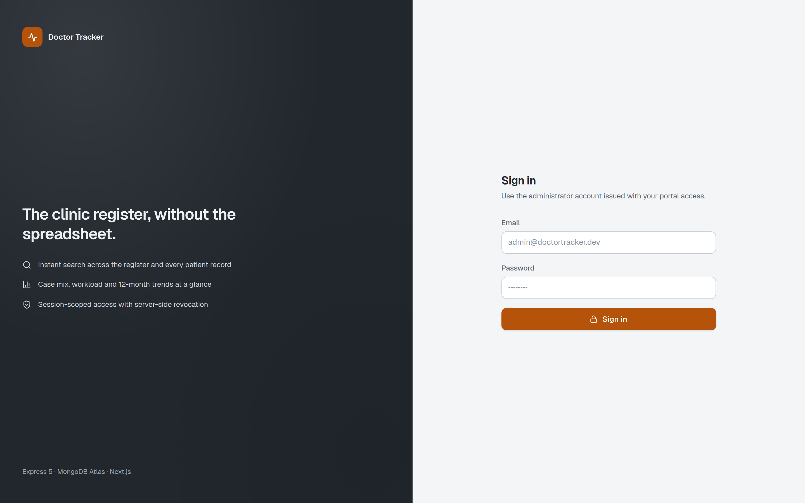 | **Sign-in.** The only unauthenticated screen; a session cookie redirects away from it. |
| 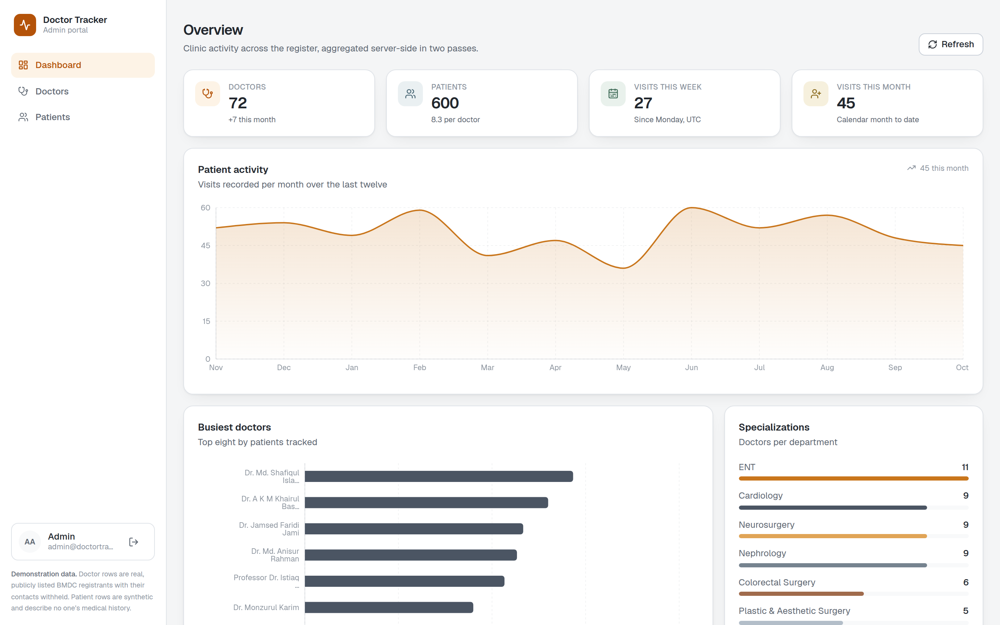 | **Dashboard.** Four counters, twelve-month visit area, top-eight doctors by patients, department distribution, case-mix donut. |
| 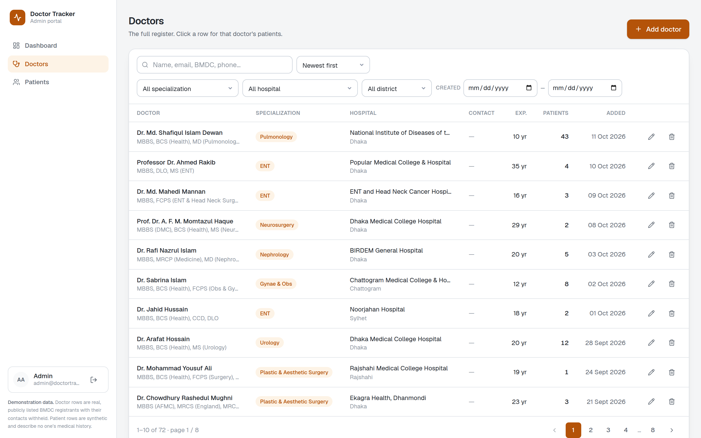 | **Doctor register.** Ten per page over 45 rows, with search, three filters, a date range and a server-whitelisted sort in one toolbar. |
| 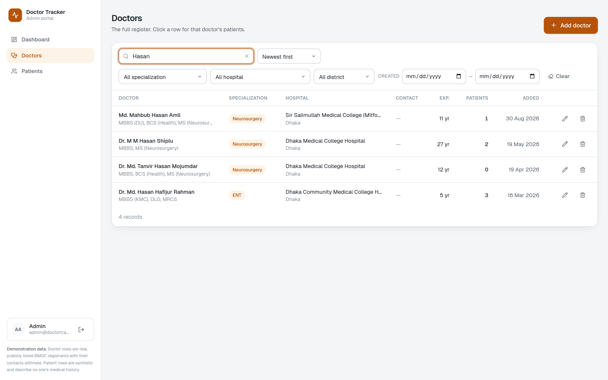 | **Search applied.** The query is in the URL, so the screen is a link — and a reload or a back gesture lands on the same rows. |
| 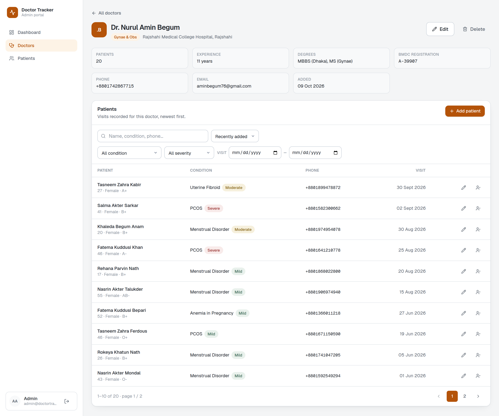 | **Doctor detail.** Facts for the record, and that doctor's own patient list — paginated, filterable, with add and remove scoped to them. |
| 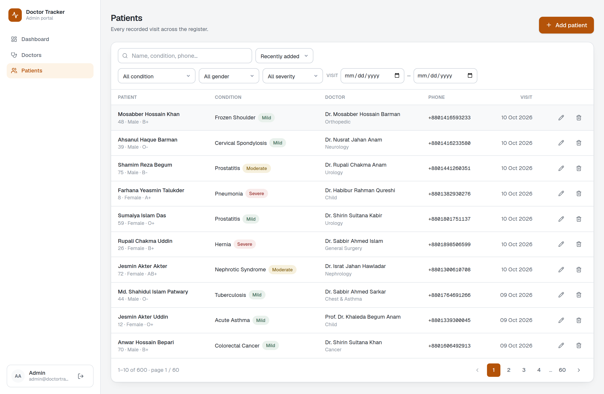 | **Patient register.** 600 rows across 60 pages, with the doctor column the per-doctor view omits and filters on condition, gender and severity. |
| 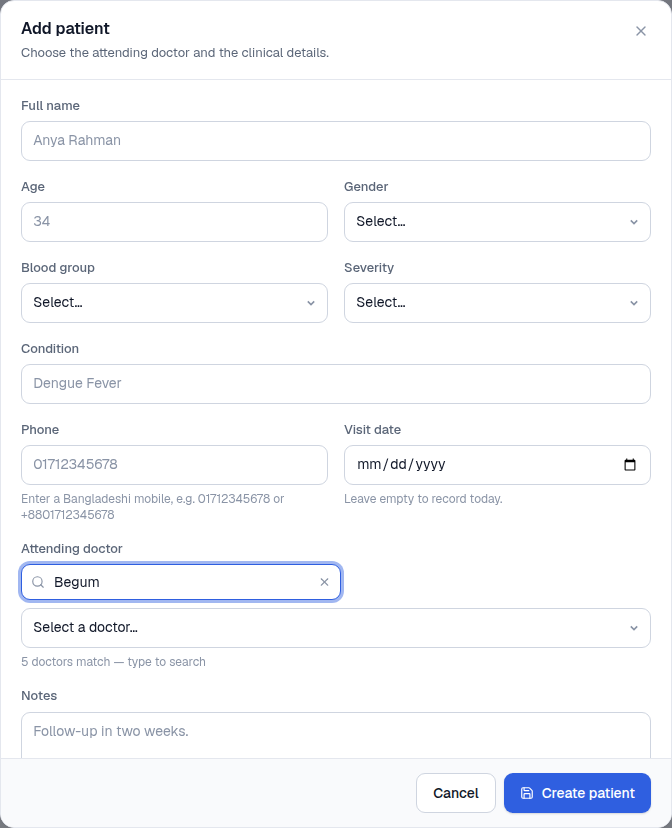 | **Add patient.** The attending-doctor picker searches server-side; the hint reports the live match count. |
| 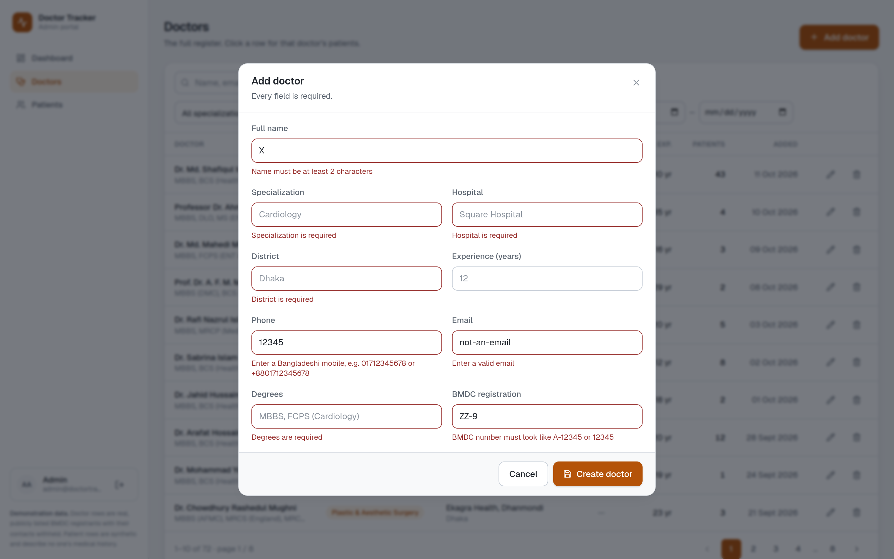 | **Field-level validation.** Every failing constraint renders under its own input, including the ones the server rejects. |

### Mobile

| | |
|---|---|
| 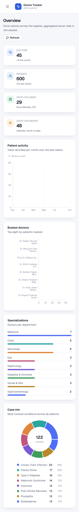 | **Dashboard.** Same aggregates; charts reflow to the viewport and the stat cards stack. |
| 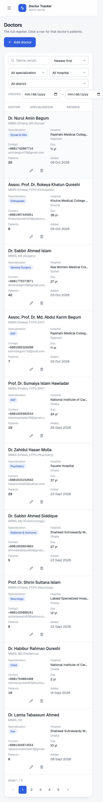 | **Doctor list as cards.** The eight-column row becomes a card with the four fields a thumb needs; the desktop table is never horizontally scrolled on a phone. |
| 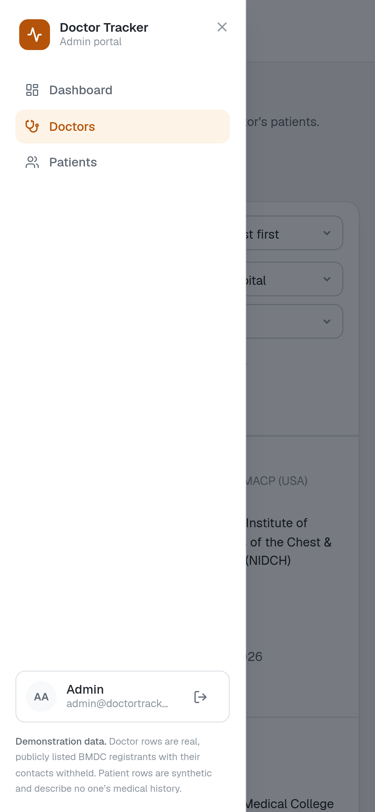 | **Navigation.** The persistent sidebar becomes a drawer with a scrim. |
| 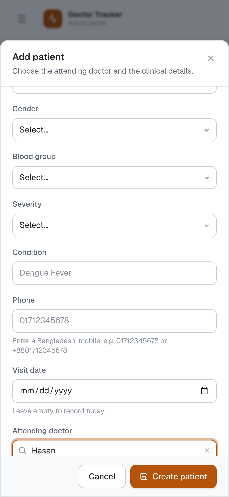 | **Add patient.** Single-column form in a dialog sized to the viewport. |
| 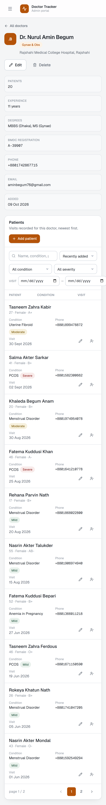 | **Doctor detail.** Facts, then that doctor's patients. |

---

## Deployment

Two services, because the spec asks for a standalone Express backend rather than a full-stack Next app:

| | | |
|---|---|---|
| `doctor-tracker-api` | **Render** — free `Web Service` | Reachable HTTPS origin for the rewrite to point at. |
| `doctor-tracker-web` | **Vercel** — free `Hobby` | The origin the browser actually sees. |
| Database | **MongoDB Atlas** — free `M0` | Already the development database; nothing to migrate. |

Deploy the API first — the web service needs its URL at build time.

### 1 — Render (API)

New ▸ Web Service ▸ connect `Mayamoho/doctor-tracker-api` ▸ branch `main`.

| Field | Value |
|---|---|
| Runtime | Node (Render reads `engines.node: ">=20.19"` from `package.json`) |
| Build command | `npm ci --include=dev && npm run build` |
| Start command | `npm start` → `node dist/server.js` |
| Health check path | `/health` |
| Instance type | Free |

Environment variables — set these in the Render dashboard, never in a committed file:

```
NODE_ENV=production
MONGO_URI=mongodb+srv://<user>:<pass>@<cluster>.mongodb.net/doctor_tracker?retryWrites=true&w=majority
JWT_ACCESS_SECRET=<node -e "console.log(require('crypto').randomBytes(48).toString('hex'))">
JWT_REFRESH_SECRET=<the same command, run again — must be a DIFFERENT value>
```

`src/config/env.ts` enforces a 32-character minimum on both secrets and exits the process on anything less, so a placeholder that survives copy-paste fails loudly at boot rather than silently minting unverifiable tokens.

`PORT` is already an environment variable on Render (`1000`) and `src/config/env.ts` reads it — do not set one. `CLIENT_ORIGIN` and `COOKIE_SECURE` are both unnecessary here: the portal reaches the API through a same-origin rewrite, and `cookieSecure` defaults to `true` under `NODE_ENV=production`.

**The `--include=dev` in the build command is load-bearing, not decoration.** Render exports `NODE_ENV=production` for Node services, and npm responds by setting `omit=dev` — so a plain `npm ci` installs no devDependencies, `typescript` is among them, and `npm run build` dies with `sh: 1: tsc: not found` after a perfectly healthy-looking install. `npm config get omit` returns `dev` under that `NODE_ENV` and empty otherwise; that is the whole failure.

Two things to know about the free tier:

- **Atlas must accept Render's traffic.** Free Render services have *dynamic* egress IPs, so no single address can be allowlisted — this cluster carries a `0.0.0.0/0` entry commented `Render + Vercel` for exactly that reason. It is the pragmatic free-tier choice and it is worth naming out loud in a review rather than hiding: the database user's credentials become the only gate, and the data behind them is synthetic. See step 2.
- **Free instances sleep after ~15 minutes idle** and the first request after that pays a cold start of up to a minute. `/health` exists for exactly this: it does no database work and no auth, so a keep-warm ping is cheap. Whether you ping it is a tradeoff with the free tier's spin-down behaviour, not a correctness requirement — the app works either way, it just answers slowly after a gap.

If `env.ts` rejects the config the process exits with the failing field named in the Render log. Read that log before debugging anything else.

#### Two failures that do not announce themselves

Verified by booting `node dist/server.js` with only those four variables and nothing else — which is exactly what a Render checkout looks like, since `.env` is gitignored:

```
MongoDB connected → …mongodb.net/doctor_tracker
Indexes synchronised in 694ms
Doctor Tracker API → http://localhost:5001/api/v1 (production)

Set-Cookie: dt_at=…; Max-Age=900;     Path=/;             HttpOnly; Secure; SameSite=Lax
Set-Cookie: dt_rt=…; Max-Age=604800;  Path=/api/v1/auth;  HttpOnly; Secure; SameSite=Lax
```

(The port in that run is 5001 because this sandbox refuses to bind 1000; Render supplies `PORT` and the app binds whatever it is given. Everything else is verbatim.)

- **The database name is the URI path.** `/doctor_tracker` is part of the connection string, not application config. Paste a URI without it and Mongoose quietly defaults to a database called `test` — observed: the service booted, connected, and reported `…mongodb.net/test` with a green health check and an empty register. It reads like a seeding failure, not a typo.
- **`COOKIE_SECURE` in a copied `.env` overrides the production default.** The app derives `secure` from `NODE_ENV=production` when the variable is absent — but dotenv only fills in what the platform left unset, so a stale `COOKIE_SECURE=false` carried over from local wins, and the session cookies lose `Secure` with no log line at all. Observed both ways on the same build. Leave the variable alone on Render.

Both legs of the auth surface behave the same as in development on that boot: `401` on an unauthenticated `/doctors`, `200` with cookies, identical `Invalid email or password` for a wrong password and an unknown account, `400` with field details for a malformed body, and `POST /auth/refresh` minting a fresh pair from the refresh cookie alone.

### 2 — The database: do not re-seed it

The deployed API points at the **same Atlas cluster and the same `doctor_tracker` database** that local development uses, so the register is already populated — 45 doctors, 600 patients, one admin user. There is nothing to migrate and nothing to seed.

`npm run seed` **drops the database before reseeding it.** Against the deployed URI that is not a reset, it is a wipe of everything the portal is showing. Only reach for it if you have deliberately pointed the service at a different database name, and then pass the seed knobs explicitly:

```bash
MONGO_URI="mongodb+srv://…/a_different_database?…" npm run seed
```

Network Access on this cluster is already open to `0.0.0.0/0` (comment `Render + Vercel`) because Render's free tier has dynamic egress IPs and no single address can be allowlisted. That is the pragmatic free-tier choice, not a recommendation: the database user's credentials are then the only gate, and the data in it is synthetic. A paid Render instance with a static outbound IP would allowlist as a `/32` instead.

The seeded `admin@doctortracker.dev / Admin@1234` is a published credential — it appears in this README and in `.env.example`. Change it in the live database before sharing the link:

```js
// Atlas ▸ Data Browse ▸ doctor_tracker  users ▸ update the admin doc's password
// with a fresh bcrypt hash, or re-run the seed against a throwaway database.
```

### 3 — Vercel (web)

Import `Mayamoho/doctor-tracker-web` ▸ branch `main`. Framework autodetects Next.js; leave build and output settings at their defaults.

One environment variable:

```
API_INTERNAL_URL=https://<your-service>.onrender.com
```

`engines.node` in `package.json` pins the build image to the same runtime the app was verified on.

Rewrites are resolved when Next builds, not per request — so `API_INTERNAL_URL` is baked into the deploy. Create the Render service first, paste its URL here, and expect to redeploy once if you get it wrong.

### 4 — Why this topology, and the one thing that breaks it

`next.config.ts` rewrites `/api/v1/:path*` to `API_INTERNAL_URL`. The browser therefore only ever talks to the Vercel origin; Next proxies to Render server-side and passes the `Set-Cookie` headers back through. That is what makes the auth cookies first-party:

- They are **host-only** — `src/utils/cookies.ts` deliberately sets no `Domain`. Adding one breaks the whole scheme, because the host the browser sees (`*.vercel.app`) is not a suffix of the Render host, and a `Domain` attribute that does not match is dropped.
- They are **`SameSite=Lax`**, which is the only setting Safari's ITP does not block outright. Cross-site `SameSite=None` cookies — the usual reflex when two services live on different domains — would silently never be stored here, and login would appear to succeed while every subsequent request was unauthenticated.

Consequences to keep in mind:

- **`SameSite=Lax` means the API is only reachable through the rewrite.** A cross-origin `fetch` from the Render host would send no cookies — Lax attaches them to top-level GET navigations only. That is intended: CORS is configured for local development, when the portal is on another port and you may want to hit `:5000` directly.
- **The proxy passthrough is not theoretical.** The verification pass drove this exact topology locally — portal on `:3100` rewriting `/api/v1/*` to the API on `:5000` — through login, refresh, protected reads and logout, with the cookies surviving as host-only first-party cookies. Render + Vercel is the same shape across two hosts instead of two ports.
- **Both legs must be HTTPS.** Vercel and Render both terminate TLS upstream; `app.set('trust proxy', 1)` exists so `req.ip` is still the real client behind exactly one hop — a permissive `true` there would let any caller spoof past the rate limiter.
- **The gate on the portal is cookie presence, not validity** (`proxy.ts`). Rendering `/dashboard` unauthenticated costs one round trip before the API returns 401 and the client redirects.

### 5 — Verify the deployed pair

| Check | Expected |
|---|---|
| `GET https://<render>/health` | `{"success":true,"data":{"status":"ok","environment":"production",…}}` |
| `GET https://<vercel>/login` | The portal sign-in screen, no console errors |
| `POST https://<vercel>/api/v1/auth/login` | `200`, and **two `Set-Cookie` headers** (`dt_at`, `dt_rt`) flagged `HttpOnly; Secure; SameSite=Lax`, host-only — **no `Domain=` attribute**. If `Domain` appears, the cookies will not attach to the Vercel origin and login loops. |
| Wrong password | `401` with the same message as an unknown account |
| Dashboard, doctors, patients | Data renders; charts animate in; reload a filtered URL and the filters come back |

Paste the Vercel URL and both repository links into the submission.

---

## Notes and limits

- **The route gate is coarse by design.** `proxy.ts` tests cookie *presence*, not validity; the API is the enforcement point and no data is reachable through the gate.
- **One admin role.** There is no per-doctor scoping, so `requireRole('admin')` is the whole authorization model — the spec asks for a single-clinic portal.
- **Deleting a doctor cascades.** The confirm dialog states how many patient records go with it, because that number is real and the action is not reversible.
- **Previously-visited routes stay in the DOM.** Next 16 keeps the subtrees of routes you have navigated away from mounted with `display: none` — in the production build as well as in development, and identical in both. They are out of the accessibility tree, so it is not a duplicate-heading bug, but any automated assertion against this app must filter by visibility or it will count rows from a table the user cannot see. A fresh document load is unaffected.
- **The desktop table scrolls horizontally below ~1700px.** Eight columns do not fit a 1440px viewport: the wrapper is `overflow-x-auto`, so the Actions column is reachable, but at 1440 the table overflows by 159px (319px at 1280) and Edit/Delete sit past the right edge until scrolled. Phones are unaffected — they render cards instead of the table. Narrowing `HOSPITAL` and `CONTACT` is the fix; it is listed here rather than hidden.
- **Seeded data is synthetic.** 45 doctors and 600 patients with Bangladeshi names, districts and BMDC-style registration numbers, generated by `npm run seed`.
